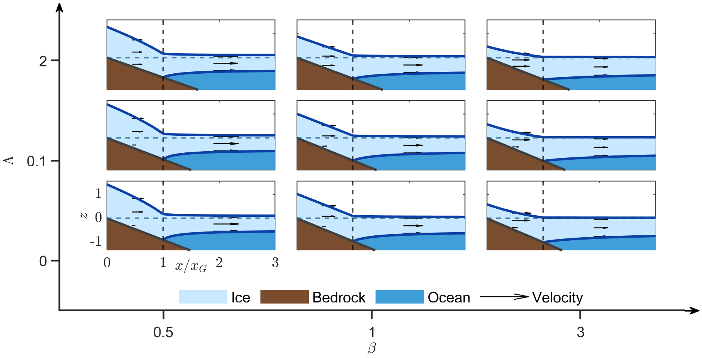
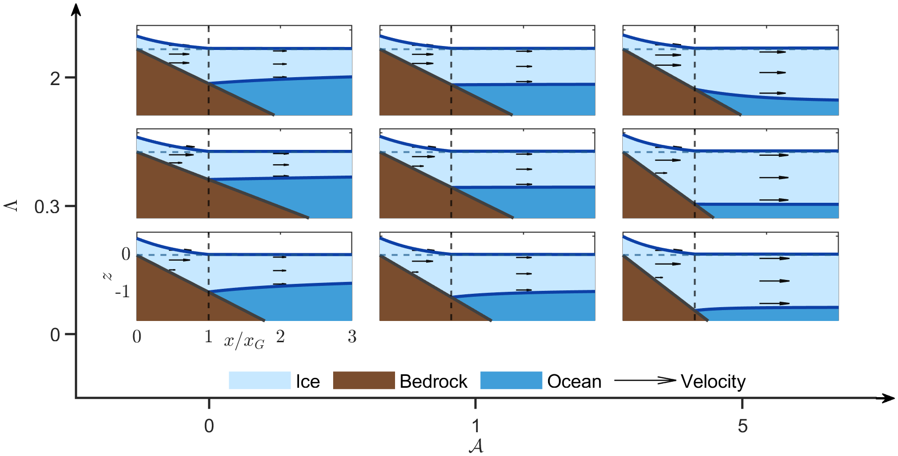
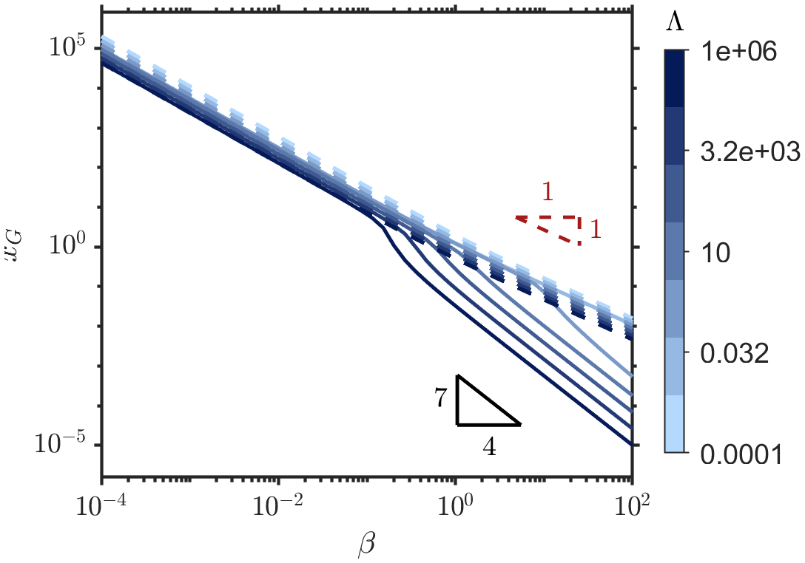

# Marine Ice Sheet Modelling

**MSc Applied Mathematics research project · University of Glasgow · 2026**

This repository contains MATLAB code developed for my MSc dissertation, *The Dynamics of Marine Ice Sheets and Ice Streams*. The project investigates how basal conditions affect the steady-state geometry of marine ice sheets, especially the position of the **grounding line** separating a grounded ice sheet from a floating ice shelf.

## Project overview

Two idealised, two-dimensional models of a marine ice sheet are developed and coupled to a floating ice shelf:

- **Shear-dominated ice sheet:** vertical shear stresses dominate the resistance to flow. The model includes partial basal slip and Newtonian or non-Newtonian rheology.
- **Extensional ice sheet:** rapid basal sliding makes longitudinal stresses dominant. The grounding-line treatment follows the matched-asymptotic framework of Schoof (2007).

The models are compared across variations in bed slope, ice accumulation, basal slip and flotation conditions.

## Numerical methods

The project uses MATLAB to:

- Solve nonlinear grounding-line conditions using **`fzero`**.
- Integrate steady-state ice sheet and shelf equations using **`ode45`**.
- Calculate ice sheet and ice shelf geometries and velocity profiles.
- Compare Newtonian and non-Newtonian solutions.
- Perform parameter sweeps and compare numerical trends with analytical or asymptotic power laws.

## Numerical studies

The main driver reproduces four groups of investigations:

| Study | Purpose |
| --- | --- |
| Parameter-variation profiles | Compare sheet and shelf profiles as bed slope, accumulation and slip vary. |
| Constant ice sheet depth | Examine special cases with constant grounded-sheet thickness. |
| Constant ice shelf depth | Examine special cases with constant floating-shelf thickness. |
| Grounding-line parameter sweeps | Explore how grounding-line position depends on model parameters and identify asymptotic scalings. |

## Selected findings

- The models can predict substantially different grounding-line positions under different basal conditions, but agree in some intermediate parameter regimes.
- For the shear-dominated model without accumulation, the grounded-sheet thickness is constant when the dimensionless bed slope is `beta = 1`.
- Numerical parameter studies reveal power-law relationships between grounding-line position and model parameters.

For derivations, assumptions and limitations, see the MSc dissertation, *The Dynamics of Marine Ice Sheets and Ice Streams* (2026).

## Running the code

1. Download or clone this repository.
2. Open **`run_all_studies.m`** in MATLAB.
3. At the top of the script, set the four study switches to `true` or `false` according to which analyses you want to run:
   - `runParameterVariationProfiles`
   - `runConstantIceSheetDepthProfiles`
   - `runConstantIceShelfDepthProfiles`
   - `runGroundingLineParameterSweeps`
4. Run the script.

The driver is **self-contained**: the numerical solvers, grounding-line functions, velocity-profile routines and plotting helpers are included as local functions. It uses built-in MATLAB functions including `fzero`, `ode45` and `exportgraphics`.

Generated PNG figures and CSV/LaTeX parameter tables are written to a **`results/`** directory beside the driver. MATLAB creates this directory automatically.

> **Note:** The full parameter sweeps may take some time. MATLAB execution and output reproduction have not been independently verified as part of preparing this GitHub repository.

## Selected results

### Effect of bed slope on ice sheet geometry

The figures below illustrate how changing the bed
slope affects the steady-state geometry of the
grounded ice sheet and floating ice shelf.

### Effect of accumulation

Comparison of steady-state ice sheet profiles
under different accumulation rates.

### Grounding-line parameter dependence

Numerical investigation of the relationship between
grounding-line position and bed slope.

## Background and acknowledgements

This research was supervised by **Dr Katarzyna Kowal** at the University of Glasgow.

The shear-dominated model extends ideas from Robison, Huppert and Worster (2010), while the extensional model draws on Schoof (2007). The associated dissertation provides a full reference list and discussion of the theoretical development.

The numerical model and grounding-line solvers were written for the MSc research project. AI assistance was used during preparation and formatting of some plotting code and thesis figures, as disclosed in the dissertation.
